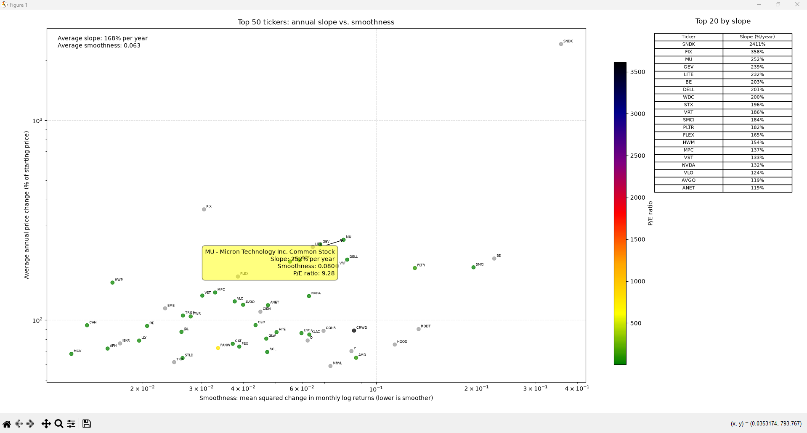

# Value Slope

Value Slope compares annualized stock-price changes with return smoothness for S&P 500 tickers. It loads market data with KaggleHub, analyzes the latest five-year period, and displays a chart of the 50 tickers with the highest annualized price change.

## Features

- Calculates annualized price change from each ticker's first and last valid monthly closing prices.
- Measures return smoothness as the mean squared change in monthly log returns; lower values indicate smoother returns.
- Shows the ticker symbol and company name when hovering over a plotted point, along with the average slope and average smoothness.
- Includes a table of the top 20 tickers ranked by annualized slope.
- Colors data points by P/E ratio: low values are green, midpoint values red, and high values black; missing or nonpositive ratios are gray.
- Uses logarithmic scales for both axes. Values must be positive to appear on a logarithmic axis.

## Requirements

Python and the following packages:

- `kagglehub[pandas-datasets]`
- `matplotlib`
- `mplcursors`
- `numpy`
- `pandas`

## Installation

Install the required packages:

```powershell
python -m pip install "kagglehub[pandas-datasets]" matplotlib mplcursors numpy pandas
```

## Usage

Run the script from the project directory:

```powershell
python value-slope.py
```

The script loads `SnP_daily_update.csv` from the Kaggle dataset and opens the chart in a Matplotlib window. It also prints each plotted ticker's annualized slope and smoothness to the console.

Company names and P/E ratios are loaded from external CSV datasets. P/E data comes from the [S&P 500 companies financials dataset](https://datahub.io/core/s-and-p-500-companies-financials/_r/-/data/constituents-financials.csv). The color scale is relative to the plotted tickers.

## Chart



## Project structure

```text
value-slope/
├── README.md
├── screenshot.png
└── value-slope.py
```
